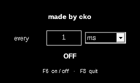

# click

An auto clicker stripped down to only what it needs to do. Black and white, 23 KB, no install, nothing running in the background.



## As minimal as it gets

click is kept as small and simple as it can be while still looking like an ordinary app to antivirus tools:

- **23 KB.** Plain C and the Windows API, nothing else. Most auto clickers are hundreds of KB to several MB.
- **One window, one setting, two keys.** Nothing else to learn or configure.
- **0% CPU when off.** It sleeps until you press F6. When on, one small thread waits on a high-precision timer between clicks.
- **No background watching.** Windows tells it only about F6 and F8. It never sees any other key you press.
- **No network, no files, no registry, no startup entry.**

An earlier build was 5 KB, made by dropping the standard C startup code and packing the file by hand. It worked the same, but several antivirus engines flagged it because of how unusual it looked. The extra 18 KB is the standard startup code that makes click look like what it is.

## Use

1. Download `click.exe` from [Releases](../../releases).
2. Run it. Set how often to click: a number plus **ms**, **seconds** or **minutes**.
3. Press **F6** to start or stop clicking. Press **F8** to quit.

It left-clicks wherever your mouse is. Changing the interval takes effect right away, even while it's running.

## Notes

- **"Windows protected your PC"** appears for new, unsigned apps. Click **More info** → **Run anyway**, or right-click `click.exe` → **Properties** → tick **Unblock**.
- **Programs running as administrator** ignore clicks from normal apps. Run `click.exe` as administrator to click in them.
- **F6 / F8 TAKEN** means another program already uses one of those keys.
- The fastest interval is 1 ms. Exact 1 ms timing needs Windows 10 (version 1803) or newer.

## Build

Written in C. Needs `gcc-mingw-w64-x86-64`:

```sh
./build.sh
```

Builds are reproducible: the same code always gives a byte-identical `click.exe`.

## License

[MIT](LICENSE)

made by cko · minimal apps, only the functionality, in black and white · [cko principles](cko-principles.md)
